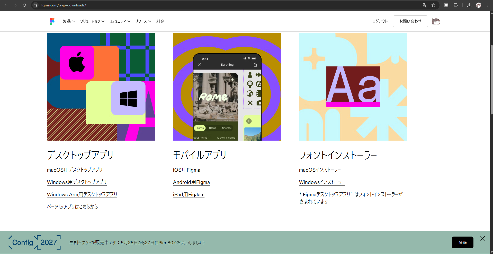
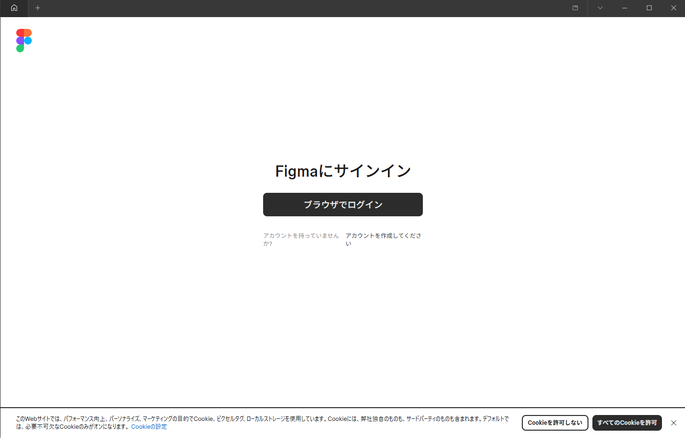
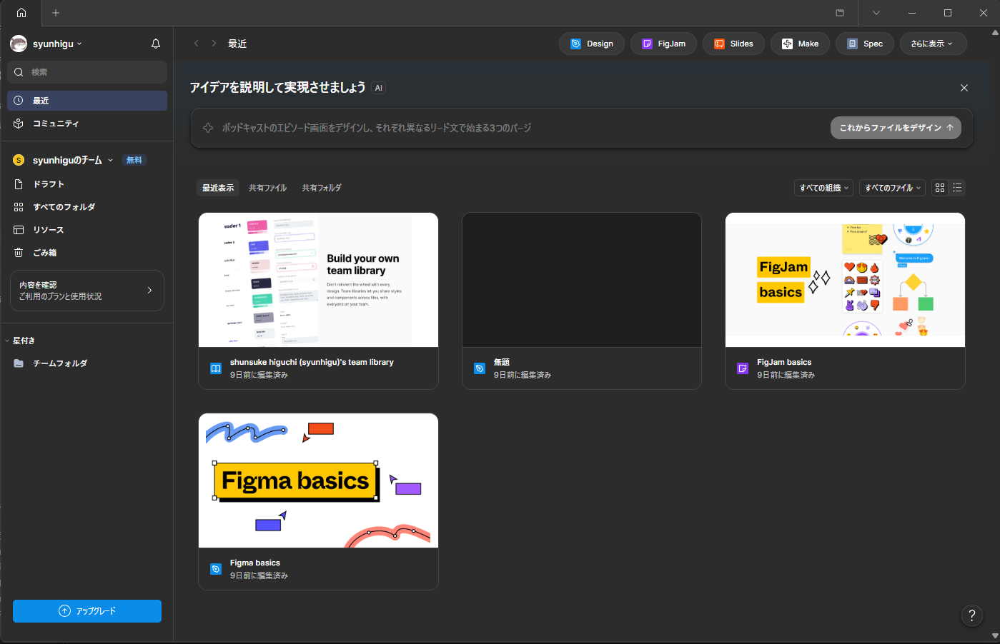
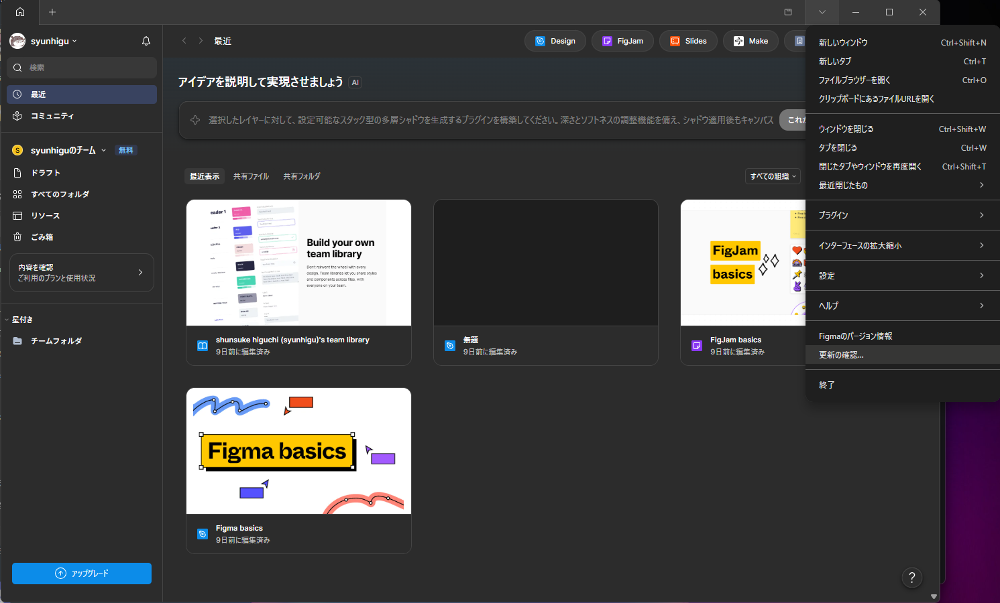
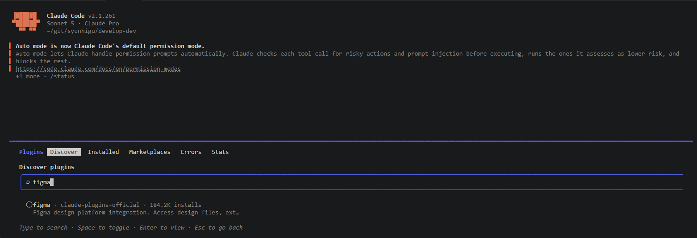
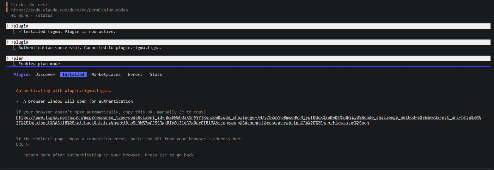
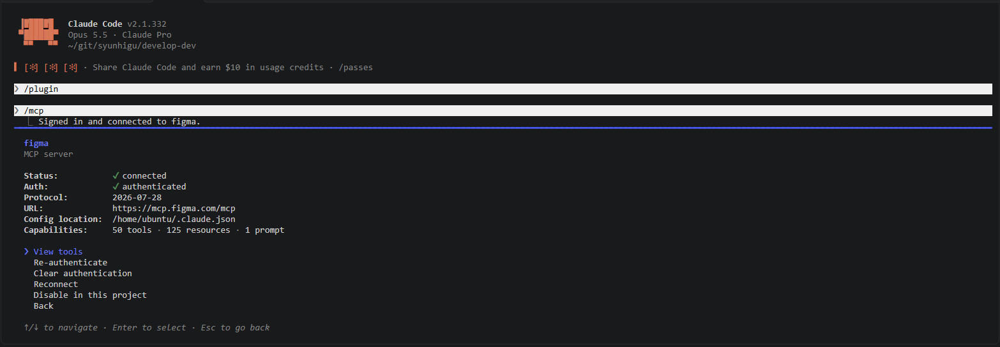

# Windows と WSL2 に Figma を導入して Claude Code と連携する

Windows 11 側に Figma デスクトップアプリを入れ、WSL2 (Ubuntu) 上の Claude Code から **Figma MCP サーバー** 経由でデザインを読み書きできるようにする手順をまとめる。

> 情報は 2026年11月 時点。Figma MCP は更新が速いので、作業前に「[参考リンク](#参考リンク)」の公式ドキュメントで最新の手順を確認すること。

## 前提環境

| 項目 | 状態 |
| --- | --- |
| OS | Windows 11 Pro |
| WSL | WSL2 + Ubuntu |
| エディタ | VS Code インストール・設定済み (WSL 拡張で Ubuntu に接続できる) |
| Claude Code | インストール・設定済み (WSL2 の Ubuntu 側で `claude` が動く) |
| Figma | Google アカウントでアカウント登録・ログイン済み |

## スクリーンショットの添付方法

手順の中の `` は、スクリーンショットを貼る場所。作業しながら画面を撮って、同じファイル名で `document/img/figma-setup/` に保存すれば、この手順書に表示される。

1. `Win + Shift + S` (Snipping Tool) で、撮りたい範囲を選んでキャプチャする
2. 通知から Snipping Tool を開き、`Ctrl + S` で保存する
3. 保存先は `document/img/figma-setup/`、ファイル名は手順の中のリンクと同じ名前 (例: `Figma_Googleログイン.png`) にする

`PrintScreen` などで Windows の「ピクチャ\スクリーンショット」フォルダーに自動保存された画像を、WSL2 のターミナルからコピーする場合 (`document` フォルダーで実行する):

```bash
# Windows のユーザー名を取得
WINUSER=$(cmd.exe /c 'echo %USERNAME%' 2>/dev/null | tr -d '\r')
# 一番新しいスクリーンショットを、指定した名前でコピー
cp "$(ls -t /mnt/c/Users/$WINUSER/Pictures/Screenshots/*.png | head -1)" ./img/figma-setup/Figma_Googleログイン.png
```

> VS Code では、マークダウンに画像をドラッグ&ドロップするか、クリップボードから貼り付ける (`Ctrl + V`) と、画像の保存とリンクの挿入を一度にできる。保存先は設定 `markdown.copyFiles.destination` で `img/figma-setup/` にしておくと便利 (このフォルダーは Figma 手順書専用なので、ワークスペースの設定 `.vscode/settings.json` に書くか、作業が終わったら設定を戻す)。
>
> ```json
> "markdown.copyFiles.destination": {
>   "**/*.md": "${documentDirName}/img/figma-setup/"
> }
> ```
>
> トークンや個人のメールアドレスが写っている場合は、モザイクをかけてから保存すること。

| ファイル名 | 撮る画面 |
| --- | --- |
| `Figma_インストール.png` | Figma デスクトップアプリのインストール完了画面 |
| `Figma_Googleログイン.png` | ブラウザの「Google で続行」画面 |
| `Figma_ログイン完了.png` | ログイン後の Figma デスクトップアプリ |
| `Figma_アップデート確認.png` | Help and account → Check for updates |
| `Figma_プラグインInstalled.png` | Claude Code の `/plugin` → Installed タブ |
| `Figma_AllowAccess.png` | ブラウザの Allow access 画面 |
| `Figma_プラグイン接続確認.png` | `/plugin` で figma が connected の画面 |
| `Figma_mcp認証.png` | `/mcp` → figma → Authenticate の画面 |
| `Figma_mcp接続確認.png` | `/mcp` で figma が connected の画面 |
| `Figma_リンクをコピー.png` | Figma の Copy link to selection メニュー |
| `Figma_動作確認.png` | Claude Code が Figma のデザインを読み込んだ結果 |
| `Figma_デスクトップMCP有効化.png` | Dev Mode 右サイドバーの Enable desktop MCP server |
| `Figma_ポート確認.png` | PowerShell の `Test-NetConnection` の結果 |
| `Figma_wslconfig.png` | `.wslconfig` の編集画面 |
| `Figma_デスクトップMCP接続確認.png` | `/mcp` で figma-desktop が connected の画面 |
| `Figma_VSCode拡張.png` | VS Code の Figma for VS Code 拡張 |

## 全体像

```text
┌──────────── Windows 11 ────────────┐      ┌─────── Figma クラウド ───────┐
│  Figma デスクトップアプリ           │      │  リモート MCP サーバー         │
│   (デスクトップ MCP: 127.0.0.1:3845) │      │  https://mcp.figma.com/mcp    │
│  ブラウザ (OAuth 認証)              │      └──────────────▲───────────────┘
│                                     │                     │ 方式A (推奨)
│  ┌──────── WSL2 Ubuntu ─────────┐   │                     │
│  │ VS Code (Remote - WSL)        │   │                     │
│  │ Claude Code ──────────────────┼───┼─────────────────────┘
│  │        └── 方式B: 127.0.0.1:3845 (mirrored 設定が必要)
│  └───────────────────────────────┘   │
└─────────────────────────────────────┘
```

Claude Code と Figma の接続方式は2つある。

| | 方式A: リモート MCP (推奨) | 方式B: デスクトップ MCP |
| --- | --- | --- |
| 接続先 | `https://mcp.figma.com/mcp` | `http://127.0.0.1:3845/mcp` |
| Figma デスクトップアプリ | 不要 | 必要 (起動しておく) |
| プラン | 全プラン (無料の Starter プランは呼び出し回数が少ない) | 有料プラン + Dev / Full シート |
| キャンバスへの書き込み | できる | できない (読み取りのみ) |
| WSL2 からの接続 | そのまま使える | ネットワーク設定 (mirrored) が必要 |

**まずは方式A を設定し、必要な場合だけ方式B を追加する** のがおすすめ。

---

## 1. Windows 側: Figma デスクトップアプリをインストールする

> Figma はブラウザ (https://www.figma.com) でも使える。デスクトップアプリは、方式B を使う場合や、ローカルのフォントを使う場合に必要。

### 方法1: winget でインストールする (PowerShell)

```powershell
winget install --id Figma.Figma -e
```

### 方法2: インストーラーでインストールする

1. https://www.figma.com/downloads/ を開く
2. 「Desktop app」の **Windows** 版をダウンロードする
3. ダウンロードした `FigmaSetup.exe` を実行する (ユーザー領域にインストールされるので管理者権限は不要)

    

### Google アカウントでログインする

1. スタートメニューから **Figma** を起動する
2. 「Log in with browser」をクリックすると、既定のブラウザが開く
3. 「**Google で続行**」を選び、登録済みの Google アカウントでログインする

    

4. 「Open Figma」と表示されたら許可する。アプリに戻ってログインできていれば完了

    

### 確認と設定

- メニュー (左上の Figma アイコン) → **Help and account** → **Check for updates** で最新版にする
  (デスクトップ MCP を使うには最新版が必要)

    

- ローカルのフォントは、デスクトップアプリをインストールすると自動で使えるようになる
  (ブラウザ版だけで使う場合は、downloads ページの **Font installer** を入れる)

---

## 2. WSL2 側: Figma の扱い

Linux 向けの **公式** Figma デスクトップアプリは無い。WSL2 の Ubuntu にはアプリを入れず、次のように使い分ける。

- **デザイン作業**: Windows 側のデスクトップアプリかブラウザで行う
- **開発作業**: WSL2 の Claude Code から **Figma MCP** でデザインを読み書きする (次の章)

> 有志が作った非公式アプリ (figma-linux) もあるが、WSLg 経由で動かすメリットは少ないので、この手順では使わない。

### (任意) WSL からブラウザを開けるようにする

Claude Code の OAuth 認証で、WSL から Windows のブラウザを開けると楽になる。

```bash
sudo apt update
sudo apt install -y wslu
# 動作確認: Windows の既定ブラウザが開けば OK
wslview https://www.figma.com
```

ブラウザが自動で開かない場合でも、ターミナルに表示された URL を Windows のブラウザに貼り付ければ認証できる。

---

## 3. 方式A: リモート MCP サーバーで Claude Code と連携する (推奨)

作業はすべて **WSL2 の Ubuntu** のターミナル (VS Code の統合ターミナルでも可) で行う。
次の2つの方法のどちらか1つを選ぶ。

### 3-1. 方法1: Claude Code プラグインで入れる (公式推奨)

MCP の設定と、Figma 用のエージェントスキルがまとめて入る。

```bash
claude plugin install figma@claude-plugins-official
```

1. Claude Code を起動中なら再起動する (`claude` を起動し直す)
2. Claude Code で `/plugin` と入力し、Enter を押す
3. 右矢印キーで **Installed** タブを開く

    

4. `figma` を選んで Enter → もう一度 Enter でサインインを始める
5. ブラウザが開くので、Figma (Google アカウント) でログインし、**Allow access** をクリックする

    

6. Claude Code に戻って再度 `/plugin` を開き、`figma` が connected になっていれば完了

    

### 3-2. 方法2: `claude mcp add` で手動登録する

```bash
# 全プロジェクトで使う場合 (おすすめ)
claude mcp add --transport http --scope user figma https://mcp.figma.com/mcp

# 今のプロジェクトだけで使う場合
# claude mcp add --transport http figma https://mcp.figma.com/mcp
```

1. Claude Code を起動し直す
2. `/mcp` と入力 → **figma** を選ぶ → **Authenticate** を選ぶ

    

3. ブラウザが開くので、Figma にログインして **Allow access** をクリックする (画面は 3-1 の Allow access と同じ)
4. Claude Code に `Authentication successful. Connected to figma` と表示されれば完了
5. もう一度 `/mcp` を開き、figma が **connected** になっていることを確認する

    

登録内容はターミナルからも確認できる。

```bash
claude mcp list
```

#### チームで共有する場合

プロジェクト直下の `.mcp.json` に URL だけ書いてコミットする (認証情報は書かない。認証は各自が `/mcp` で行う)。

```json
{
  "mcpServers": {
    "figma": {
      "type": "http",
      "url": "https://mcp.figma.com/mcp"
    }
  }
}
```

### 3-3. 動作確認

1. Figma で対象のフレームを右クリック → **Copy/Paste as** → **Copy link to selection** でリンクをコピーする

    

2. Claude Code で次のように依頼する

```text
このFigmaのフレームを確認して、構成を説明して
https://www.figma.com/design/XXXXXXXX/ファイル名?node-id=1-2
```

```text
このFigmaのデザインを React + Tailwind で実装して
https://www.figma.com/design/XXXXXXXX/ファイル名?node-id=1-2
```

Figma のツール (`get_design_context` など) の実行許可を求められたら許可する。


---

## 4. 方式B: デスクトップ MCP サーバーを使う (任意・有料プラン向け)

Figma デスクトップアプリで今選んでいるレイヤーを、リンクなしで Claude Code に渡したい場合に使う。
**有料プラン (Professional 以上) の Dev / Full シート** が必要。

### 4-1. Windows 側: デスクトップ MCP サーバーを有効にする

1. Figma デスクトップアプリを最新版にして、デザインファイルを開く
2. 何も選択していない状態で **Shift + D** を押し、Dev Mode に切り替える
3. 右サイドバーの **MCP server** セクションで **Enable desktop MCP server** をクリックする
4. 画面下に、サーバーが起動したことを知らせるメッセージが出れば OK

    

PowerShell で起動を確認する。

```powershell
Test-NetConnection 127.0.0.1 -Port 3845
# TcpTestSucceeded : True なら OK
```


### 4-2. WSL2 から Windows の 127.0.0.1 に届くようにする (mirrored networking)

デスクトップ MCP サーバーは Windows の `127.0.0.1` でしか待ち受けない。WSL2 は標準 (NAT モード) だと別のネットワークなので、そのままでは接続できない。
**mirrored networking モード** にすると、WSL2 から `127.0.0.1` で Windows 側に接続できるようになる。

1. Windows のエクスプローラーで `%UserProfile%` を開き、`.wslconfig` を作成または編集する

```ini
[wsl2]
networkingMode=mirrored
```


2. PowerShell で WSL を再起動する

```powershell
wsl --shutdown
```

3. Ubuntu を開き直して、接続を確認する

```bash
curl -i http://127.0.0.1:3845/mcp
# HTTP のレスポンスが返れば、接続できている (エラー内容のレスポンスでも可)
```

> **注意**: mirrored モードにすると WSL2 全体のネットワーク動作が変わる (Docker など、ポートを使う他のツールにも影響する)。
> 変えたくない場合は、Figma 公式フォーラムで紹介されている `netsh interface portproxy` + `socat` で中継する方法がある (参考リンク参照)。
> どちらも面倒なら、**方式A (リモート) を使うのが一番簡単**。

### 4-3. Claude Code に登録する

```bash
claude mcp add --transport http --scope user figma-desktop http://127.0.0.1:3845/mcp
```

Claude Code を再起動して `/mcp` を開き、`figma-desktop` が connected になっていれば完了。


Figma デスクトップアプリでレイヤーを選択した状態で「選択中のFigmaレイヤーを実装して」と依頼すると、選択中のレイヤーをもとに作業してくれる。

> 古い記事にある `http://127.0.0.1:3845/sse` (SSE 方式) は旧仕様。今は `/mcp` (HTTP 方式) を使う。

---

## 5. (任意) VS Code との連携

### Figma for VS Code 拡張

VS Code の拡張機能で **Figma for VS Code** (発行元: Figma) を検索してインストールすると、エディタ内で Figma ファイルの閲覧、Dev Mode の検査、コメントの確認ができる。
サイドバーの Figma アイコンから **Sign in** し、ブラウザで Google アカウントでログインして許可する。


### Claude Code 以外 (GitHub Copilot など) から MCP を使う場合

コマンドパレット (`Ctrl + Shift + P`) → **MCP: Open User Configuration** を開き、`mcp.json` に次を追加する。

```json
{
  "servers": {
    "figma": {
      "type": "http",
      "url": "https://mcp.figma.com/mcp"
    }
  }
}
```

保存後、サーバー名の上に出る **Start** をクリックし、**Allow access** で認証する。
(Claude Code だけで使うなら、この設定は不要)

---

## 6. トラブルシューティング

| 症状 | 原因と対処 |
| --- | --- |
| `/mcp` で figma が `failed` / `needs authentication` | `/mcp` → figma → **Authenticate** でもう一度認証する。それでも直らない場合は、`claude mcp remove figma` してから登録し直す |
| 認証時にブラウザが開かない | ターミナルに出た URL を Windows のブラウザに貼り付ける。または `wslu` を入れる (2章) |
| 認証後に Claude Code に戻らない / コールバックが失敗する | `.wslconfig` で `localhostForwarding=false` にしていないか確認する。mirrored モードにすると直ることもある |
| 方式B で `connection refused` | ① デスクトップアプリで MCP server が有効か ② `.wslconfig` が mirrored か ③ `wsl --shutdown` で再起動したか、を確認する |
| すぐに呼び出し上限になる | Starter プランや View / Collab シートは、MCP ツールの呼び出し回数がとても少ない (月数回程度)。本格的に使うなら Dev / Full シートが必要。最新の上限は公式の「Rate limits」で確認する |
| 古い記事の手順と違う | 2025年の記事はデスクトップ MCP (旧称 Dev Mode MCP) や SSE が中心。今はリモート MCP とプラグインでの導入が推奨 |

---

## 参考リンク

### 公式ドキュメント (最新情報はここで確認する)

- [Figma MCP Server ドキュメント (Figma for Developers)](https://developers.figma.com/docs/figma-mcp-server/)
- [Remote server installation (方式A)](https://developers.figma.com/docs/figma-mcp-server/remote-server-installation)
- [Local / desktop server installation (方式B)](https://developers.figma.com/docs/figma-mcp-server/local-server-installation)
- [How to set up the Figma remote MCP server (Figma ヘルプセンター)](https://help.figma.com/hc/en-us/articles/35281350665623-Figma-MCP-collection-How-to-set-up-the-Figma-remote-MCP-server)
- [Figma ダウンロードページ (デスクトップアプリ・フォントインストーラー)](https://www.figma.com/downloads/)
- [Claude Code MCP ドキュメント](https://docs.anthropic.com/en/docs/claude-code/mcp)
- [WSL のネットワーク (mirrored モード) - Microsoft Learn](https://learn.microsoft.com/ja-jp/windows/wsl/networking)

### WSL2 固有の情報

- [MCP Server, Claude Code and WSL (Figma Forum)](https://forum.figma.com/report-a-problem-6/mcp-server-claude-code-and-wsl-42517) — mirrored モード、portproxy、socat での解決方法

### Qiita / Zenn などの記事

- [VSCode + Claude Code + Figma MCPで始めるAIコーディング環境構築ガイド (Qiita, 2026年3月更新)](https://qiita.com/albedo_qiita/items/893359c04c1900d6fac6)
- [Claude CodeからFigmaを操作できるようになったので試してみた (Qiita)](https://qiita.com/kobayashimakoto/items/357add591df55fee1585)
- [デザインの在りかをリポジトリに書くとAIエージェントがFigmaまで辿れる (Qiita)](https://qiita.com/zucky-quest/items/d65e03e298c9e636160f)
- [Claude Code × Figma Dev Mode MCP × Playwright MCPでフロントエンド開発を爆速化 (Qiita)](https://qiita.com/makojii/items/21c7faf1ff424958d9ed)
- [Figma × Claude Code MCP (Zenn)](https://zenn.dev/devtatsu/articles/figma-claude-code-mcp)
- [Figma MCP 環境構築メモ (Zenn)](https://zenn.dev/morimorihayashi/articles/figma-mcp-environment-memo)
- [Figma MCPとは?使い方とClaude Code・Codexでの設定手順を整理](https://ai.giftx.co.jp/blog/figma-mcp/)

### 新しい記事を探すときの検索リンク

記事は日々増えるので、次の検索結果を新しい順に並べて確認する。

- [Qiita: 「Figma MCP」の新着記事](https://qiita.com/search?q=Figma%20MCP&sort=created)
- [Qiita: 「Figma Claude Code」の新着記事](https://qiita.com/search?q=Figma%20%22Claude%20Code%22&sort=created)
- [Qiita: 「Figma WSL」の新着記事](https://qiita.com/search?q=Figma%20WSL&sort=created)
- [Zenn: 「Figma MCP」の検索結果](https://zenn.dev/search?q=Figma%20MCP)
- [Zenn: Figma トピック](https://zenn.dev/topics/figma)
